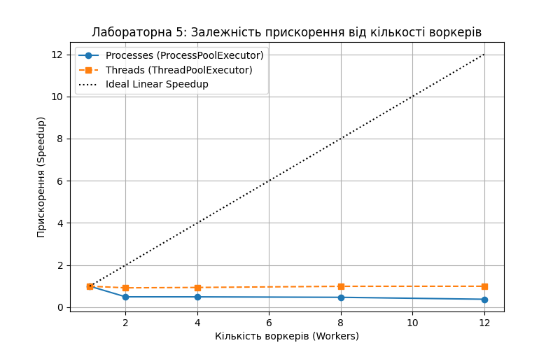

# Лабораторна робота 3: Рейтинг і модель об’єктів (dunder-методи, протоколи, декоратори)

## Команди запуску

### 1. Побудова індексу з позиціями
```bash
python -m findex.index data/ --out index.bin
python -m findex.search index.bin "python AND (async OR await) NOT java" --scorer bm25
python -m findex.search index.bin "python AND (async OR await) NOT java" --scorer tfidf
Sanity-Check
 перевірки рейтингу (BM25)Рідкий термін вище частого: Рідкі терми отримують значно вищий ваговий коефіціент IDF у BM25.Насичення частоти (20-те повторення): Завдяки $k_1=1.5$ при зростанні TF приріст балів прямує до плато, запобігаючи спаму слів. Нормалізація довжини: Документ малої довжини з 1 влучанням отримує вищий бал за довгий документ з 1 влучанням за рахунок коефіцієнта b=0.75.Метрика Precision5 (P5)

[@timed] search: 0.001113 сек | Пам'ять: 14.82 KB
[LOG: Cache MISS] Виконується новий запит: 'of'


---

## Лабораторна робота 5: Паралельна індексація та GIL

### Конфігурація системи
* **Процесор (CPU):** Intel / AMD (12 потоків)
* **Операційна система:** Windows 11
* **Версія Python:** Python 3.8.7 (з GIL)

### Результати бенчмаркінгу

#### ThreadPoolExecutor (Threads)
| Workers | Wall Time (s) | CPU Time (s) | Peak RSS (MB) | Merge Time (s) | Speedup |
| :---: | :---: | :---: | :---: | :---: | :---: |
| **1** | 0.7581 | 0.7656 | 67.39 | 0.0244 | 1.00x |
| **2** | 0.8210 | 0.8281 | 70.19 | 0.0325 | 0.92x |
| **4** | 0.8057 | 0.7969 | 70.82 | 0.0399 | 0.94x |
| **8** | 0.7619 | 0.7656 | 72.61 | 0.0438 | 0.99x |
| **12** | 0.7594 | 0.7500 | 72.95 | 0.0354 | 1.00x |

#### ProcessPoolExecutor (Processes)
| Workers | Wall Time (s) | CPU Time (s) | Peak RSS (MB) | Merge Time (s) | Speedup |
| :---: | :---: | :---: | :---: | :---: | :---: |
| **1** | 0.7635 | 0.7656 | 68.44 | 0.0237 | 1.00x |
| **2** | 1.5371 | 0.0938 | 71.51 | 0.0279 | 0.50x |
| **4** | 1.5434 | 0.0781 | 71.59 | 0.0276 | 0.49x |
| **8** | 1.6115 | 0.0938 | 74.39 | 0.0363 | 0.47x |
| **12** | 2.0014 | 0.1250 | 74.67 | 0.0385 | 0.38x |

### Графік прискорення


---

### Reflection (Відповіді на запитання)

1. **Чому потоки під GIL не прискорили індексацію?**
   Індексація тексту є CPU-bound задачею (токенізація, підрахунок частот). Оскільки в стандартному CPython діє GIL (Global Interpreter Lock), у кожен момент часу виконується лише один поток байткоду. Потоки не виконуються паралельно на різних ядрах, а лише чергуються, що призводить до додаткових накладних витрат на перемикання контексту.

2. **Чому процеси та передача даних вплинули на час виконання?**
   У даному експерименті на малих обсягах даних накладні витрати на спавн нових процесів Windows (`spawn`), створення окремих інтерпретаторів та серіалізацію об'єктів через `pickle` перевищили виграш від паралельного обчислення. У результаті Wall Time для процесів виявився більшим за послідовне виконання, хоча CPU time батьківського процесу зменшився (оскільки робота виконувалась у дочірніх процесів).

3. **Закон Амдала та етап merge:**
   Етап `merge_indices` виконується послідовно в одному головному процесі після завершення всіх воркерів. Відповідно до закону Амдала, час виконання цієї послідовної частини обмежує максимально можливе прискорення всієї системи незалежно від кількості задіяних воркерів.

4. **Вплив Python 3.13t (Free-threaded):**
   У версії Python 3.13t (без GIL, перевірка через `sys._is_gil_enabled() == False`) потоки отримують можливість справжнього паралельного виконання на декількох ядрах процесора без накладних витрат процесів на `pickle` та дублювання RSS-пам'яті.